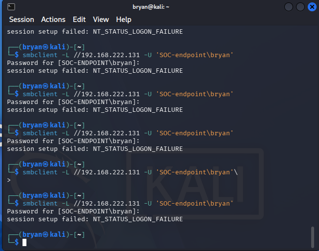
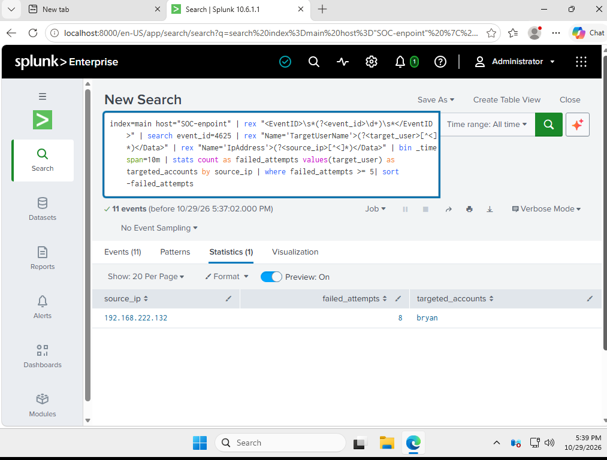
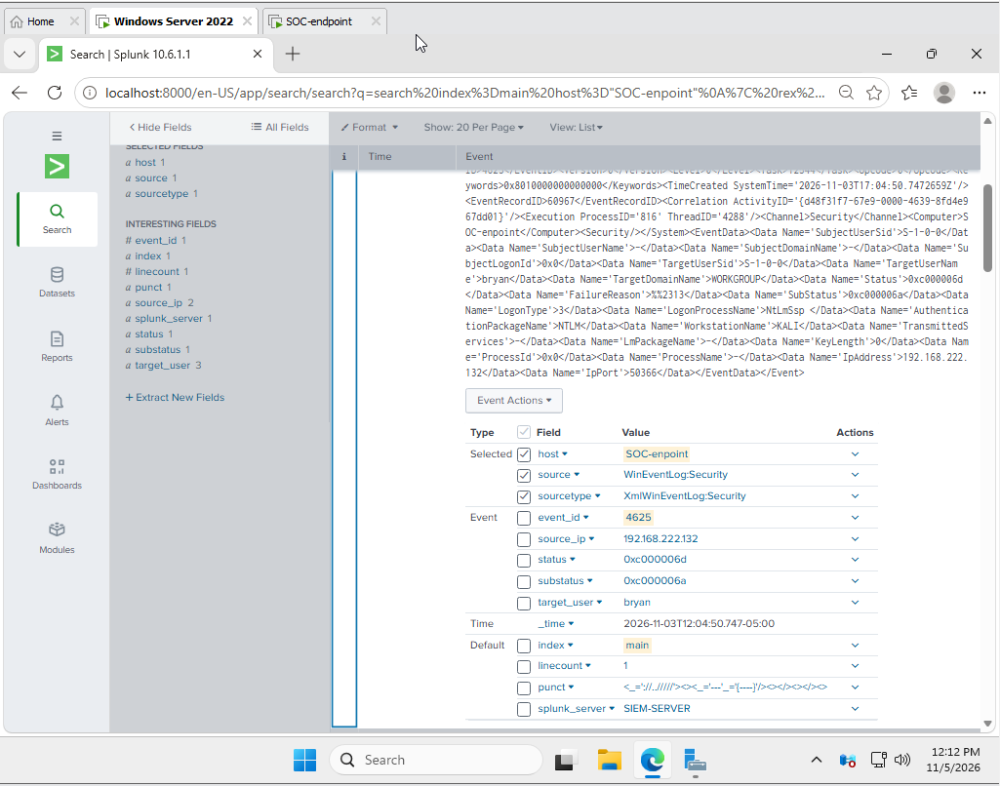
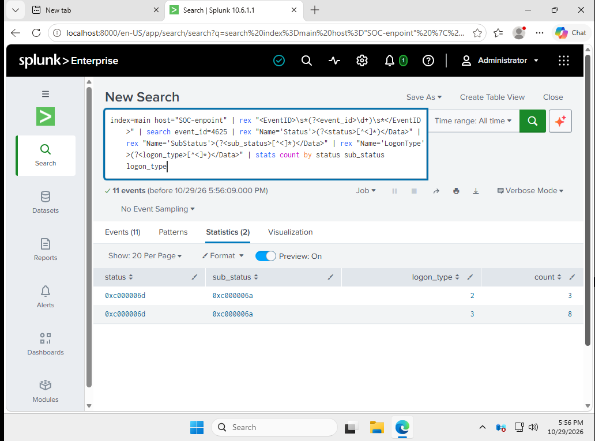
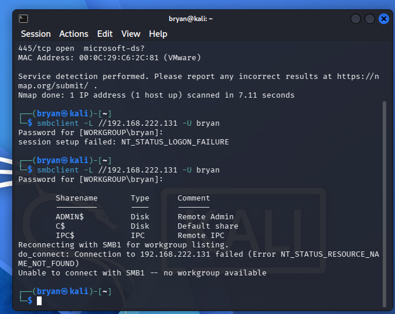
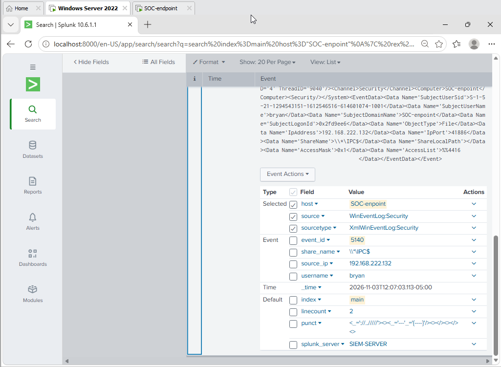
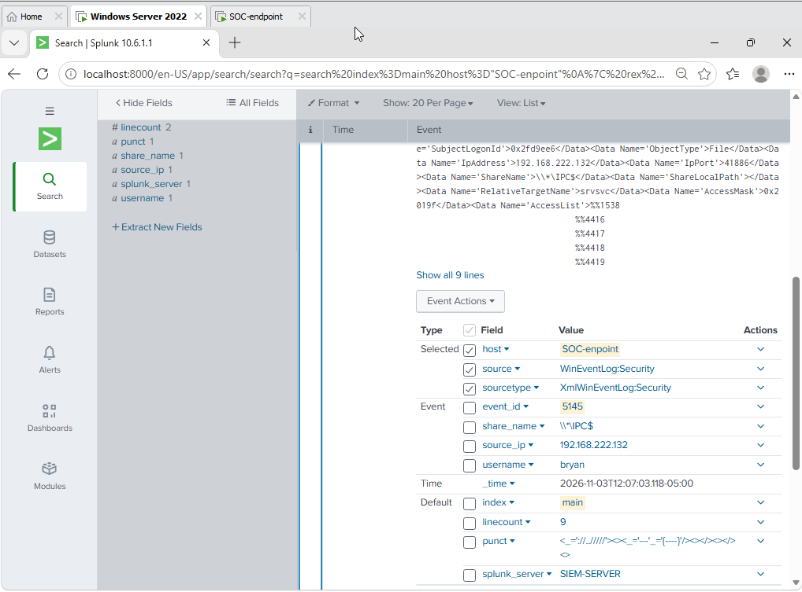
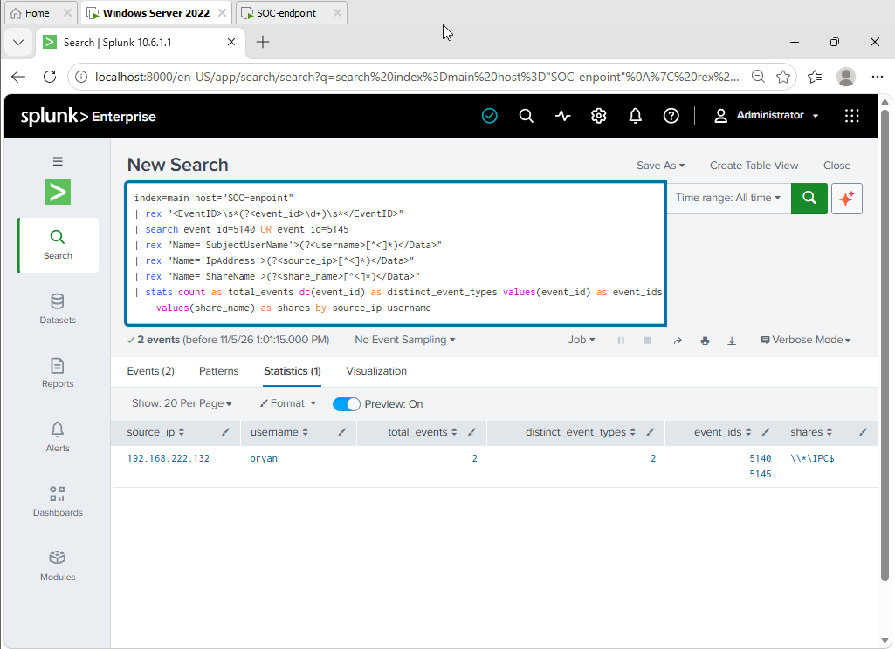

# SIEM Threat Detection & Incident Investigation Lab

**A hands-on SOC lab demonstrating Windows security monitoring, controlled attack simulations, SIEM detection engineering, and incident investigation using Splunk Enterprise.**

This project demonstrates the process of generating controlled security activity, collecting Windows Security telemetry, identifying suspicious behavior, investigating events with SPL, and presenting findings through a centralized SOC monitoring dashboard.

---

## Project Highlights

- Built a virtualized security monitoring environment using VMware.
- Configured Splunk Enterprise to analyze Windows Security event logs.
- Performed two controlled security attack simulations using Kali Linux.
- Investigated Windows Security Event IDs 4625, 5140, and 5145.
- Developed SPL searches to extract and correlate security event information.
- Mapped observed activity to MITRE ATT&CK.
- Created a centralized Splunk SOC monitoring dashboard.
- Documented attack evidence and investigation findings.

## Attack Simulation Evidence

**The following sections provide direct access to the attack simulations and supporting evidence.**

These are the most important hands-on demonstrations in this project.

### Attack 1 — Failed Authentication

<strong>View Failed Authentication Attack Evidence</strong>

**Objective:** Simulate failed SMB authentication attempts against a Windows endpoint using invalid credentials.

**Tools:** Kali Linux, smbclient

**Target:** Windows Server — `192.168.222.131`

**Attacker:** Kali Linux — `192.168.222.132`

**Detection:** Windows Security Event ID `4625`

**MITRE ATT&CK:** T1110 — Brute Force

**Attack execution evidence:**

**Splunk detection evidence:**

**Windows event investigation:**

**Investigation results:**

[View all Failed Authentication Evidence](Screenshots/Attack-01-Failed-Authentication/)

[Read the Failed Authentication Investigation Report](Documentation/investigation-01-failed-authentication.md)

### Attack 2 — SMB Network Share Enumeration

<strong>View SMB Network Share Enumeration Attack Evidence</strong>

**Objective:** Identify SMB services and enumerate available Windows network shares.

**Tools:** Kali Linux, Nmap, smbclient

**Target:** Windows Server — `192.168.222.131`

**Attacker:** Kali Linux — `192.168.222.132`

**Detection:** Windows Security Event IDs `5140` and `5145`

**MITRE ATT&CK:** T1135 — Network Share Discovery

**Attack execution evidence:**

**Windows Event ID 5140:**

**Windows Event ID 5145:**

**Splunk investigation results:**

[View all SMB Enumeration Evidence](Screenshots/Attack-02-SMB-Enumeration/)

[Read the SMB Enumeration Investigation Report](Documentation/investigation-02-smb-enumeration.md)

---

## Lab Architecture

The project uses a virtualized environment consisting of a Windows endpoint, a Kali Linux testing machine, and Splunk Enterprise.

| Component | Technology | Purpose |
|---|---|---|
| Host Machine | Windows 11 | Virtualization host |
| Hypervisor | VMware Workstation Pro 17.5.2 | Virtual machine management |
| SIEM | Splunk Enterprise | Security event collection and analysis |
| Monitored Endpoint | Windows Server 2025 | Windows Security telemetry |
| Testing Machine | Kali Linux | Controlled attack simulations |

### Network Configuration

| System | IP Address |
|---|---|
| Windows Endpoint | `192.168.222.131` |
| Kali Linux | `192.168.222.132` |

### Splunk Configuration

- **Index:** `main`
- **Host field:** `SOC-enpoint`
- **Source type:** `XmlWinEventLog:Security`

[View Lab Architecture and Environment Documentation](Documentation/lab-architecture.md)

---

## Detection Engineering

Two investigation searches were developed using Splunk Search Processing Language (SPL).

| Detection | Windows Event IDs | MITRE ATT&CK |
|---|---|---|
| Failed Authentication | 4625 | T1110 — Brute Force |
| SMB Network Share Enumeration | 5140, 5145 | T1135 — Network Share Discovery |

The SPL searches extract relevant fields, aggregate event activity, identify source systems, and support investigation of suspicious behavior.

**Explore the detection logic:**

- [Detection Rule 01 — Failed Authentication](Detection-Rules/01-failed-authentication.md)
- [Detection Rule 02 — SMB Network Share Enumeration](Detection-Rules/02-smb-network-share-enumeration.md)

---

## Splunk SOC Monitoring Dashboard

A centralized Splunk dashboard was developed to visualize the Windows endpoint security telemetry generated during both investigations.

### 1. Dashboard Overview

### 2. Security Event Analysis

### 3. Authentication Investigation

---

## Investigation Reports

Detailed investigation reports document the attack methodology, collected evidence, Splunk findings, MITRE ATT&CK mappings, and analyst assessments.

- [Investigation 01 — Failed Authentication](Documentation/investigation-01-failed-authentication.md)
- [Investigation 02 — SMB Network Share Enumeration](Documentation/investigation-02-smb-enumeration.md)

---

## Skills Demonstrated

**SIEM and Detection Engineering**
- Splunk Enterprise
- Search Processing Language (SPL)
- Security event analysis
- Field extraction and event aggregation
- Dashboard development

**Windows Security**
- Windows Security Event Logging
- Windows audit policy configuration
- Authentication failure investigation
- SMB network share monitoring

**Network Security**
- Nmap
- smbclient
- SMB service enumeration
- Network activity investigation

**SOC Operations**
- Attack simulation
- Security event investigation
- MITRE ATT&CK mapping
- Evidence collection
- Technical incident reporting

---

## Project Status

**Core investigations, detection searches, and dashboard completed.**

The lab currently includes two controlled attack simulations, corresponding Windows Security event investigations, documented SPL detection searches, and a centralized monitoring dashboard.

Potential future improvements include automated Splunk alerting, additional Windows event detections, and expanded attack simulations.

## Disclaimer

All security testing was performed within a controlled virtual lab environment using systems under my control. The project was developed for educational and defensive cybersecurity purposes.
